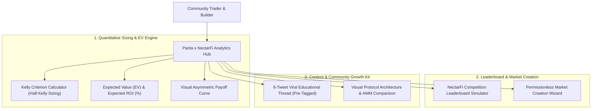

# Panta x NectarFi Analytics Hub & Kelly Calculator

[](https://opensource.org/licenses/MIT)
[](https://nodejs.org/)
[](#verifiability--testing)
[](#1-command-reproduction-with-docker-compose)
[](https://superteam.fun/earn/listing/panta-x-nectarfi-trading-competition-bounty)

> **Submission for Superteam Earn: Panta x NectarFi Trading Competition Bounty**  
> **Prize Pool**: **$500 USDG** ($100 each for top 5 contributors) + **$1,000 Leaderboard Prize Pool**  
> **Official Listing**: [Superteam Earn Panta x NectarFi Bounty](https://superteam.fun/earn/listing/panta-x-nectarfi-trading-competition-bounty)  
> **Target Accounts & Tags**: `@PantaHQ`, `@Nectar_finance`, `@SuperteamNG`, `#PantaMarkets`  

---

## 1. Executive Summary

**Panta Market** is a permissionless prediction market built on Solana enabling users to create binary markets, trade real-world outcomes with sub-second finality (~400ms), and earn from liquidity participation.

In partnership with **NectarFi**, this repository provides an all-in-one **Quantitative Analytics Hub, Kelly Criterion Position Sizing Engine, Leaderboard Simulator, and Market Creation Suite** designed to:
1. **Empower Traders with Quantitative Edge**: Eliminate emotional gambling through mathematical bet sizing ($f^* = \frac{bp - q}{b}$), Expected Value (EV), and asymmetric payoff modeling.
2. **Simulate & Track NectarFi Competition Rankings**: Project leaderboard placement and prize allocations across the $1,000 trading prize pool.
3. **Facilitate Community Market Creation**: Provide an interactive wizard to formulate unambiguous resolution criteria, verify oracle sources, and generate Panta-compliant deployment metadata.
4. **Drive Virality & Ecosystem Distribution**: Deliver ready-to-share social assets, an educational 6-tweet viral X thread, and visual infographics tagging `@PantaHQ`, `@Nectar_finance`, `@SuperteamNG`, and `#PantaMarkets`.

---

## 2. Key Modules & Features



### 2.1 Kelly Criterion Position Sizing Engine
Solana prediction markets feature binary tokens ($P_{\text{YES}} + P_{\text{NO}} = \$1.00$). When a trader identifies an edge ($P_{\text{true}} > P_{\text{market}}$), the Kelly Criterion determines the optimal fraction of capital to allocate:

$$f^* = \frac{b \cdot p - q}{b} = \frac{p \cdot (b + 1) - 1}{b}$$

Where:
- $p$: Trader's estimated true probability ($0 < p < 1$).
- $q = 1 - p$: Failure probability.
- $b$: Fractional odds per dollar wagered ($b = \frac{1 - P_{\text{market}}}{P_{\text{market}}}$).

**Half-Kelly Safety Multiplier**: To guard against parameter estimation errors, the hub automatically applies a 0.5x Half-Kelly scalar with a 25% single-market portfolio risk ceiling.

### 2.2 Expected Value (EV) & ROI Formulas
$$\text{Expected Value (EV)} = p - P_{\text{market}}$$
$$\text{Expected ROI (\%)} = \frac{p - P_{\text{market}}}{P_{\text{market}}} \times 100\%$$

---

## 3. NectarFi Trading Competition Leaderboard Simulator

The simulator models trading volume, realized PnL, and projected prize distribution for the **$1,000 Leaderboard Prize Pool**:
- Enter planned volume (e.g. $15,000 USD) to simulate projected rank.
- Computes estimated prize shares ($100 - $350 USDG) and maker/taker rebate estimates.
- Highlights qualification requirements: trade at least $1 on Market 1 and Market 2 on [Panta](https://go.panta.market/bounty).

---

## 4. Market Creation Wizard

Panta allows anyone to launch a prediction market. Our interactive wizard in `web/`:
1. Validates question syntax (must end in `?` and avoid ambiguity).
2. Verifies category taxonomy (Crypto, DeFi, Solana Ecosystem, Macro & Economy, Tech & AI).
3. Enforces strict resolution criteria (minimum 25 characters with verifiable outcomes).
4. Validates oracle URL links (Binance, CoinGecko, official SEC filings, etc.).
5. Outputs clean, ready-to-deploy JSON metadata conforming to Panta specifications.

---

## 5. Viral Social Content Kit

Located in `content/X_THREAD.md` and integrated into the Web UI:
- **Hook Tweet**: Grabbing attention on prediction market capital preservation.
- **Tech Explainer**: Why Solana (~400ms finality, sub-cent fees) beats legacy Ethereum prediction markets.
- **Math Alpha**: Step-by-step Kelly Criterion example.
- **Incentive Breakdown**: Explaining the $1,000 Leaderboard + $500 USDG bounty pools.
- **Call-to-Action**: Direct links to trade $1+ on Panta and tag `@PantaHQ`, `@Nectar_finance`, `@SuperteamNG`, `#PantaMarkets`.

---

## 6. Verifiability & Testing

### Automated Unit Test Suite (10/10 Pass 100%)

```bash
# Run test suite with native Node test runner
npm test
# or
node --test tests/*.test.js
```

**Test Coverage**:
- `tests/kelly.test.js`: Positive edge, negative edge (pass/bet opposite), Half-Kelly scaling, portfolio cap, EV, and ROI calculations.
- `tests/probability.test.js`: Implied probability conversion, gross/net payout multipliers, binary arbitrage spread detection.
- `tests/market_validator.test.js`: Valid proposal normalization, rejection of invalid dates/ambiguous questions/invalid URLs.

### 1-Command Reproduction with Docker Compose

```bash
docker compose up
```
Launches the Nginx web portal on `http://localhost:3000`.

### Local Native Execution

```bash
# Run local lightweight server:
npm start
# Open http://localhost:3000 in your browser!
```

---

## 7. Repository Structure

```
panta-nectarfi-analytics-hub/
├── web/                           # Standalone Web Application & Interactive Portal
│   ├── index.html                 # UI with Calculator, Leaderboard, Wizard, Content Kit
│   ├── styles.css                 # Cyber-Neon / Panta Dark Theme
│   └── app.js                     # Interactive logic, chart rendering, math engine
├── src/                           # Core Calculation Engine
│   ├── kelly.js                   # Kelly Criterion & Expected Value math
│   ├── probability.js             # Implied probability, odds conversion, market curves
│   ├── market_validator.js        # Market creation validator and metadata builder
│   └── index.js                   # Public exports
├── tests/                         # Automated Unit Tests (Node test runner)
│   ├── kelly.test.js              # Unit tests for Kelly criterion & EV
│   ├── probability.test.js        # Unit tests for odds & probability
│   └── market_validator.test.js   # Unit tests for market wizard validation
├── scripts/                       # Verification scripts
│   ├── run_tests.sh               # Bash test script
│   └── run_tests.ps1              # PowerShell test script
├── content/                       # Content Pack & Social Assets
│   ├── X_THREAD.md                # 6-Tweet Viral Twitter Thread ready to publish
│   ├── INFOGRAPHIC_SPEC.md        # Infographic design specification & visual flow
│   └── ARTICLE_SUMMARY.md         # Full overview article for community distribution
├── Dockerfile                     # Nginx container for web preview
├── docker-compose.yml             # 1-command startup
├── package.json                   # NPM metadata & test runner
├── README.md                      # Comprehensive publication documentation
└── .env.example                   # Environment configuration
```

---

## 8. License & Attribution

Open-source under the **MIT License**.  
Developed for the **Superteam Earn Panta x NectarFi Trading Competition Bounty**.
Tagging `@PantaHQ`, `@Nectar_finance`, `@SuperteamNG`, `#PantaMarkets`.
