# Infographic Architecture & Visual Flow: Panta Market x NectarFi

This document specifies the visual infographic architecture for community education and social sharing.

---

## 1. Visual Flow: How Panta Binary Markets Work

```mermaid
flowchart TD
    subgraph MarketCreation ["1. Permissionless Market Creation"]
        Creator["Market Creator"] --> Formulate["Formulates Clear Binary Question"]
        Formulate --> Seed["Seeds Initial Liquidity (YES / NO Pool)"]
        Seed --> Live["Market Goes Live on Solana"]
    end

    subgraph TradingPhase ["2. Real-Time Trading & Price Discovery"]
        TraderA["Trader A (Bullish YES)"] --> BuyYes["Buys YES at $0.40"]
        TraderB["Trader B (Bearish NO)"] --> BuyNo["Buys NO at $0.60"]
        BuyYes --> AMM["Panta Automated Market Maker"]
        BuyNo --> AMM
        AMM --> ImpliedProb["Implied Probability: 40% YES / 60% NO"]
    end

    subgraph Settlement ["3. Oracle Resolution & Payout"]
        EventOccurs["Real-World Event Resolves"] --> Oracle["Decentralized Oracle Verification"]
        Oracle --> ResultYES["Resolves YES = $1.00 (NO = $0.00)"]
        ResultYES --> PayoutA["Trader A Redeems $1.00 per share (+150% Profit!)"]
        ResultYES --> PayoutB["Trader B Receives $0.00"]
    end
```



---

## 2. Panta vs Traditional Prediction Platforms

| Feature Dimension | Traditional Prediction Markets (Ethereum/Off-chain) | Panta Market on Solana |
| :--- | :--- | :--- |
| **Settlement Speed** | 12 - 60 seconds (block confirmation delays) | ~400ms Sub-second Solana Finality |
| **Transaction Fees** | $2.00 - $25.00 per transaction | < $0.001 (Fraction of a cent) |
| **Market Creation** | Centralized curation or heavy staking bonds | 100% Permissionless with community seeding |
| **Liquidity Efficiency** | Static order books with wide bid-ask spreads | High-frequency AMM with tight liquidity bonding |
| **Ecosystem Synergy** | Isolated DApp | Integrated with NectarFi & Solana DeFi ecosystem |

---

## 3. The Kelly Criterion Advantage

```
┌────────────────────────────────────────────────────────────────────────┐
│                        KELLY CRITERION MATRIX                          │
├──────────────────┬─────────────────┬─────────────────┬─────────────────┤
│ Market Price ($) │ True Chance (%) │ Full Kelly (f*) │ Half-Kelly Rec. │
├──────────────────┼─────────────────┼─────────────────┼─────────────────┤
│ $0.30 (30%)      │ 50% (+20% Edge) │ 28.6% Bankroll  │ 14.3% Bankroll  │
│ $0.40 (40%)      │ 60% (+20% Edge) │ 33.3% Bankroll  │ 16.7% Bankroll  │
│ $0.50 (50%)      │ 70% (+20% Edge) │ 40.0% Bankroll  │ 20.0% Bankroll  │
│ $0.60 (60%)      │ 75% (+15% Edge) │ 37.5% Bankroll  │ 18.8% Bankroll  │
│ $0.70 (70%)      │ 65% (-5% Edge)  │ -16.7% (PASS!)  │ 0.0% (NO BET)   │
└──────────────────┴─────────────────┴─────────────────┴─────────────────┘
```
